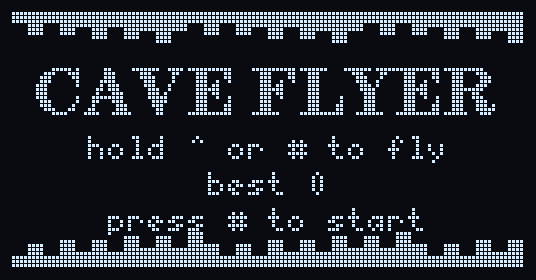
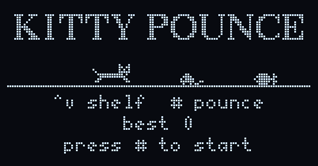
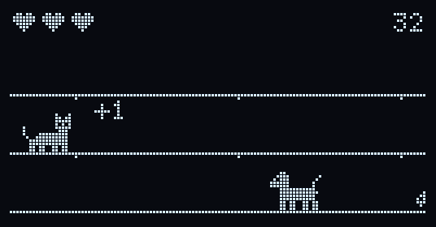
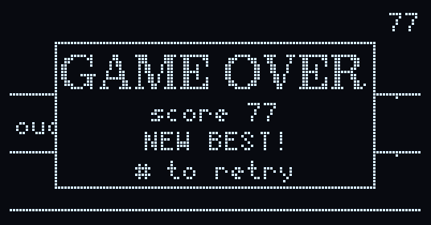
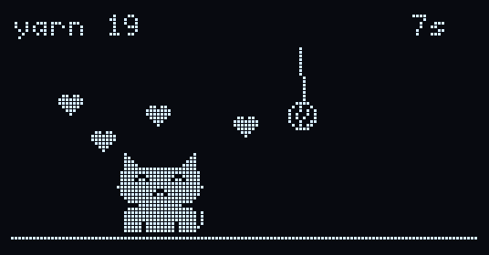
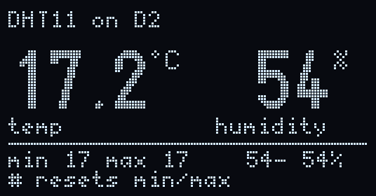

# Nano OLED Games

Small games for an **Arduino Nano** with a **1.3" 128x64 I2C OLED** module that has 4 buttons (^, v, #, *).

| Game | Folder | What it is |
| --- | --- | --- |
| Cave Flyer | [`cave_flyer/`](cave_flyer) | Fly through an endless scrolling cave that narrows and speeds up. Hold ^ or # to climb. |
| Kitty Pounce | [`kitty_pounce/`](kitty_pounce) | A cat guards three shelves: pounce on mice, dodge dogs, eat fish for extra hearts. |
| Pocket Kitty | [`pocket_kitty/`](pocket_kitty) | Virtual pet cat. Feed, play catch-the-yarn, nap and bathe Mochi. She reacts to your real room temperature (DHT11). Progress is saved. |
| Screen test | [`oled_test/`](oled_test) | I2C scan, display test patterns and a button tester. |
| DHT11 test | [`dht_test/`](dht_test) | Shows room temperature and humidity with min/max. |

## Screenshots

### Cave Flyer
<table>
<tr><td></td><td></td><td></td></tr>
</table>

### Kitty Pounce
<table>
<tr><td></td><td></td><td></td></tr>
</table>

### Pocket Kitty
<table>
<tr><td></td><td></td><td></td></tr>
<tr><td></td><td></td><td></td></tr>
<tr><td></td><td></td><td></td></tr>
</table>

Mochi's room is cold (17 °C) in these shots, so it snows outside her window. The last image is the DHT11 test sketch.

These are rendered from the real sketches on a PC, not photographed: [`tools/screenshots/`](tools/screenshots)
runs each game with a fake Arduino core and an autopilot, and saves U8g2's screen buffer.
Run `tools/screenshots/build.sh` to regenerate them after changing a game.

## Hardware

- Arduino Nano (ATmega328P)
- 1.3" 128x64 OLED, **SSD1306** controller, I2C address `0x3C`, with 4 push buttons

| OLED pin | Nano pin |
| --- | --- |
| GND | GND |
| VCC | 5V |
| SCL | A5 |
| SDA | A4 |
| K1 (^) | D12 |
| K2 (v) | D11 |
| K3 (#) | D10 |
| K4 (*) | D9 |

DHT11 temperature/humidity sensor (3-pin module): DATA -> D2, VCC -> 5V, GND -> GND.
Only Pocket Kitty and the DHT11 test use it.

Buttons connect to GND when pressed (the sketches use `INPUT_PULLUP`).

> Many 1.3" modules use the SH1106 controller instead. If the picture is shifted or has a noisy stripe,
> change `U8G2_SSD1306_128X64_NONAME_...` to `U8G2_SH1106_128X64_NONAME_...` at the top of the sketch.

## Building

Requires the [U8g2](https://github.com/olikraus/u8g2) library. Pocket Kitty and the DHT11 test also need
Adafruit's "DHT sensor library" (and its dependency "Adafruit Unified Sensor").

With [arduino-cli](https://arduino.github.io/arduino-cli/):

```sh
arduino-cli core install arduino:avr
arduino-cli lib install U8g2 "DHT sensor library" "Adafruit Unified Sensor"
arduino-cli compile -b arduino:avr:nano pocket_kitty
arduino-cli upload  -b arduino:avr:nano -p /dev/ttyUSB0 pocket_kitty
```

Many Nano clones have the old bootloader: if upload fails with `not in sync`, use
`-b arduino:avr:nano:cpu=atmega328old`. In the Arduino IDE that is *Tools → Processor → ATmega328P (Old Bootloader)*.

## Notes

- Best scores and the pet's state are stored in EEPROM, each game in its own slot.
  - Cave Flyer / Kitty Pounce: hold **v** at power-on to reset the best score.
  - Pocket Kitty: hold **\*** at power-on to adopt a new kitty.
- Pocket Kitty room reactions: below 18 °C it snows outside the window and Mochi shivers and gets hungry faster;
  at 27 °C and up the sun shines and she sweats and tires faster. Change `COLD_C` / `HOT_C` to adjust.
- The Nano has only 2 KB of RAM. Pocket Kitty uses U8g2 page mode (`_2_` constructor) to save 768 bytes.
