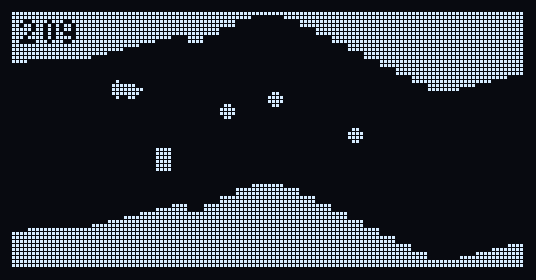
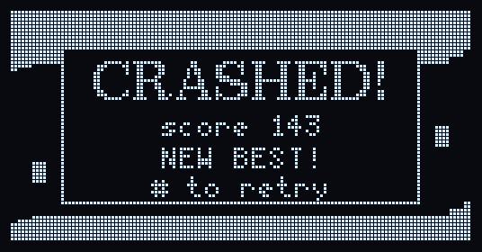
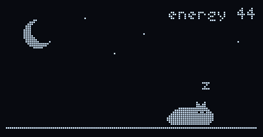
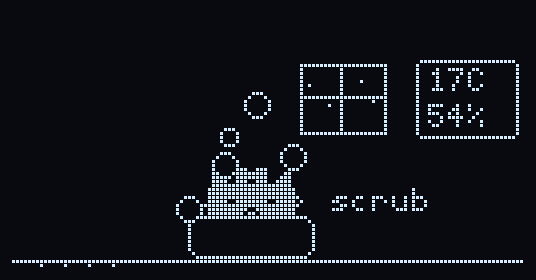
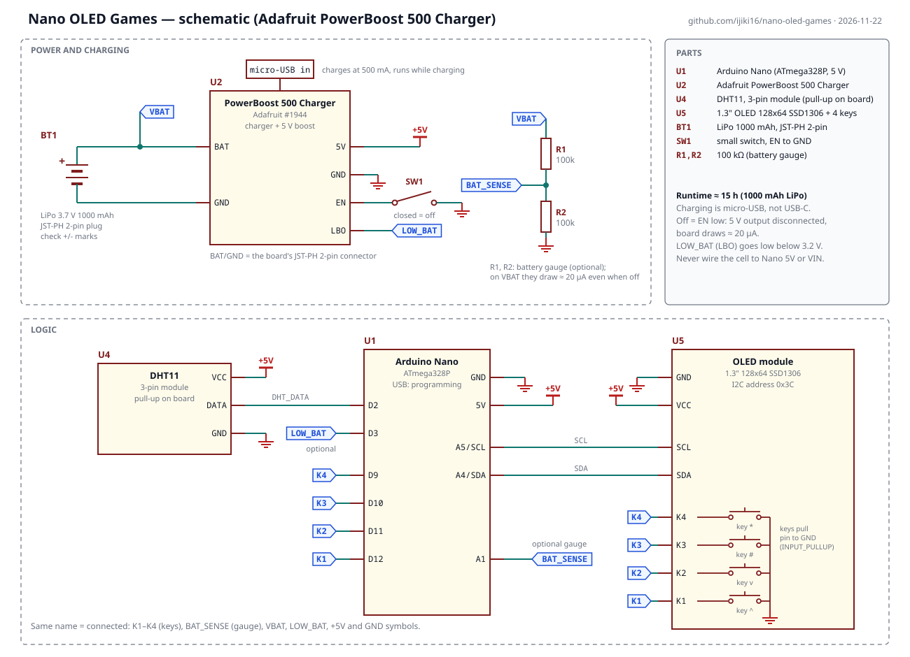

# Nano OLED Games

Small games for an **Arduino Nano** with a **1.3" 128x64 I2C OLED** module that has 4 buttons (^, v, #, *).

| Game | Folder | What it is |
| --- | --- | --- |
| Cave Flyer | [`cave_flyer/`](cave_flyer) | Fly through an endless scrolling cave that narrows and speeds up. Hold ^ or # to climb. |
| Kitty Pounce | [`kitty_pounce/`](kitty_pounce) | A cat guards three shelves: pounce on mice, dodge dogs, eat fish for extra hearts. |
| Pocket Kitty | [`pocket_kitty/`](pocket_kitty) | Virtual pet cat. Feed, play catch-the-yarn, nap and bathe Mochi. She reacts to your real room temperature (DHT11). Progress is saved. |
| Screen test | [`oled_test/`](oled_test) | I2C scan, display test patterns and a button tester. |
| DHT11 test | [`dht_test/`](dht_test) | Shows room temperature and humidity with min/max. |

## Screenshots

### Cave Flyer
<table>
<tr><td></td><td></td><td></td></tr>
</table>

### Kitty Pounce
<table>
<tr><td></td><td></td><td></td></tr>
</table>

### Pocket Kitty
<table>
<tr><td></td><td></td><td></td></tr>
<tr><td></td><td></td><td></td></tr>
<tr><td></td><td></td><td></td></tr>
</table>

Mochi's room is cold (17 °C) in these shots, so it snows outside her window. The last image is the DHT11 test sketch.

These are rendered from the real sketches on a PC, not photographed: [`tools/screenshots/`](tools/screenshots)
runs each game with a fake Arduino core and an autopilot, and saves U8g2's screen buffer.
Run `tools/screenshots/build.sh` to regenerate them after changing a game.

## Schematic

The full device: LiPo battery, Adafruit PowerBoost 500 Charger, Nano, OLED module with its keys, DHT11 and the
optional battery gauge (see [Battery power](#battery-power)). [SVG version](docs/schematics/schematic.svg)



Regenerate it with `python3 tools/schematic/make_schematics.py`.

## Hardware

- Arduino Nano (ATmega328P)
- 1.3" 128x64 OLED, **SSD1306** controller, I2C address `0x3C`, with 4 push buttons

| OLED pin | Nano pin |
| --- | --- |
| GND | GND |
| VCC | 5V |
| SCL | A5 |
| SDA | A4 |
| K1 (^) | D12 |
| K2 (v) | D11 |
| K3 (#) | D10 |
| K4 (*) | D9 |

DHT11 temperature/humidity sensor (3-pin module): DATA -> D2, VCC -> 5V, GND -> GND.
Only Pocket Kitty and the DHT11 test use it.

Optional battery gauge: battery divider (100k/100k) -> A1. See [Battery power](#battery-power).

Buttons connect to GND when pressed (the sketches use `INPUT_PULLUP`).

> Many 1.3" modules use the SH1106 controller instead. If the picture is shifted or has a noisy stripe,
> change `U8G2_SSD1306_128X64_NONAME_...` to `U8G2_SH1106_128X64_NONAME_...` at the top of the sketch.

## Battery power

The Nano needs a steady 5 V, but a LiPo cell gives 3.0–4.2 V. The
[Adafruit PowerBoost 500 Charger](https://learn.adafruit.com/adafruit-powerboost-500-plus-charger) (#1944)
charges the cell and boosts it to 5 V on one board:

**LiPo → PowerBoost 500 Charger (charger + 5 V boost) → Nano 5V pin**

The device draws about 40 mA at 5 V (Nano ~20–25 mA, OLED 10–20 mA, DHT11 <1 mA), which is about 64 mA
from the cell after boost losses: **about 15 hours** on a 1000 mAh cell.

### Parts

| Part | Notes |
| --- | --- |
| Adafruit PowerBoost 500 Charger (#1944) | Charger + 5 V boost. Charges over micro-USB at up to 500 mA. |
| 3.7 V 1S LiPo, e.g. **1000 mAh**, with protection board and **JST-PH 2-pin (2.0 mm)** plug | Adafruit's own LiPos plug straight in. Fits flat behind the OLED board. |
| Small slide switch | On/off, between EN and GND. |
| 2 × 100 kΩ resistors | Voltage divider for Pocket Kitty's battery gauge (optional). |

### Wiring

| PowerBoost pin | Connect to |
| --- | --- |
| JST-PH connector (BAT / GND) | The battery. **Check the +/- marks** next to the connector first: some LiPos have the wires swapped in the plug. |
| 5V / GND | Nano 5V / GND |
| EN | Switch to GND. EN is pulled high to the battery; closing the switch turns the 5 V output off. |
| LBO | Optional: Nano D3. It drops to 0 V below 3.2 V (and lights the board's red LED). No game reads it yet. |
| BAT | Optional: battery gauge divider, BAT → 100k → A1 → 100k → GND. |

```
LiPo (JST-PH) -> PowerBoost BAT/GND      PowerBoost 5V  -> Nano 5V pin
                                         PowerBoost GND -> Nano GND
PowerBoost EN  -- switch -- GND          (closed = off)
PowerBoost LBO -> Nano D3                (optional)
PowerBoost BAT -- 100k --+-- 100k -- GND (optional gauge)
                         +--> Nano A1
```

- **Charging:** plug micro-USB into the PowerBoost. The device keeps running while it charges.
- **Off** only disconnects the 5 V output: the board still draws about 20 µA, plus about 20 µA through the
  gauge divider, which sits on the always-on battery line.
- **Uploading code** over the Nano's USB with the battery on is safe, but switching it off keeps the battery
  reading honest.
- **Never** connect the cell directly to the Nano's 5V or VIN pin. VIN needs 7 V or more.
- Unlike cheap IP5306 "power bank" boards, the PowerBoost does not switch itself off at low load.
- Optional: removing the Nano's power LED saves 3–5 mA, about 10% more runtime.

### Battery gauge in Pocket Kitty

With the divider wired to A1, Pocket Kitty shows a battery icon in the top-right corner and a battery bar on
the INFO screen. Below 15% Mochi says "low battery!", below 5% "charge me!", and she saves her progress
before the battery runs out. If A1 is not wired, set `BATTERY_MONITOR` to `false` at the top of the sketch.
An unconnected A1 reads random values. If the percentage looks wrong, measure the Nano's 5V pin and put that
value in `VREF_MV`.

## Building

Requires the [U8g2](https://github.com/olikraus/u8g2) library. Pocket Kitty and the DHT11 test also need
Adafruit's "DHT sensor library" (and its dependency "Adafruit Unified Sensor").

With [arduino-cli](https://arduino.github.io/arduino-cli/):

```sh
arduino-cli core install arduino:avr
arduino-cli lib install U8g2 "DHT sensor library" "Adafruit Unified Sensor"
arduino-cli compile -b arduino:avr:nano pocket_kitty
arduino-cli upload  -b arduino:avr:nano -p /dev/ttyUSB0 pocket_kitty
```

Many Nano clones have the old bootloader: if upload fails with `not in sync`, use
`-b arduino:avr:nano:cpu=atmega328old`. In the Arduino IDE that is *Tools → Processor → ATmega328P (Old Bootloader)*.

## Notes

- Best scores and the pet's state are stored in EEPROM, each game in its own slot.
  - Cave Flyer / Kitty Pounce: hold **v** at power-on to reset the best score.
  - Pocket Kitty: hold **\*** at power-on to adopt a new kitty.
- Pocket Kitty room reactions: below 18 °C it snows outside the window and Mochi shivers and gets hungry faster;
  at 27 °C and up the sun shines and she sweats and tires faster. Change `COLD_C` / `HOT_C` to adjust.
- The Nano has only 2 KB of RAM. Pocket Kitty uses U8g2 page mode (`_2_` constructor) to save 768 bytes.
